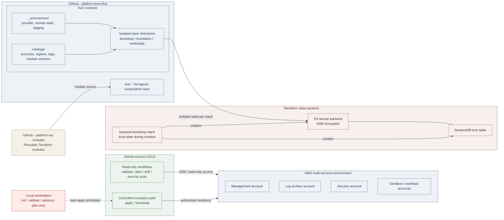

<!-- markdownlint-disable-file MD030 MD046 -->

# Platform Live Infrastructure

This repository (`platform-live-infra`) is the live-composition layer for the
platform infrastructure. It declares and orchestrates Terraform stacks using
Terragrunt, consuming reusable modules from the separate `platform-iac-modules`
repository. It does not contain module implementations.

Each Terragrunt stack under `live/` is an isolated Terraform state unit. Stacks
declare provider configuration, remote state, and dependency wiring. State is
never merged across stack boundaries.

---

## Architecture at a Glance



---

## Readiness Status

!!! danger "Not Production-Ready"
    Account identifiers, backend bucket and region, DynamoDB lock table, KMS
    key references, and other catalog metadata contain unresolved `TBD`
    placeholders. Until those values are supplied through a reviewed
    configuration change:

    - Remote backend initialization will fail for all normal stacks.
    - Bootstrap apply is blocked.
    - `task plan` at default strictness (`STRICT=0`) may pass while silently
      skipping placeholder-related errors. Always use `STRICT=1` for
      authoritative results.
    - No routine automated apply workflow is enabled — the checked-in
      `apply.yml` runs with `APPLY=false` and no AWS credentials.

    Do not infer readiness from a passing static check, green validation
    workflow, or a successful `task plan` run at default strictness.

---

## Documentation

<div class="grid cards" markdown>

-   :material-book-open-page-variant: **Repository Overview & Execution Policy**

    ---

    Platform architecture, toolchain setup, execution policy, and failure
    recovery.

    [:octicons-arrow-right-24: Repository](https://github.com/Mahdiar-Farzinfar/platform-live-infra)

-   :material-console-network: **Bootstrap Guide**

    ---

    Backend creation, state migration to remote, and bootstrap
    controlled-exception procedure.

    [:octicons-arrow-right-24: bootstrap.md](bootstrap.md)

-   :material-laptop: **Cross-Platform Setup**

    ---

    Local environment setup for Windows, macOS, and Linux. Dev Container
    configuration.

    [:octicons-arrow-right-24: cross-platform.md](cross-platform.md)

-   :material-sort-clock-ascending: **Deployment Order**

    ---

    Deployment DAG, 10 leaf stacks across 5 phases, Terragrunt-enforced vs.
    inventory-defined dependencies.

    [:octicons-arrow-right-24: deployment-order.md](deployment-order.md)

-   :material-cog-play: **Operations Guide**

    ---

    Operation-class taxonomy, Taskfile entry points, prohibited operations,
    and CI-only mutations.

    [:octicons-arrow-right-24: operations.md](operations.md)

-   :material-database-lock: **State Management**

    ---

    State architecture, backend configuration, bootstrap and migration
    procedures, locking, and safe operating procedure.

    [:octicons-arrow-right-24: state-management.md](state-management.md)

</div>

---

## Execution Policy

| Context | Permitted |
| --- | --- |
| Local workstation | Read-only inspection, setup, `CHECK=true` formatting, `-backend=false` validation, advisory planning with authorized credentials |
| Local workstation | **Prohibited:** `task apply`, direct state edits, force-unlock without an authorized recovery procedure |
| GitHub Actions — routine | Plan, drift detection, static validation, security scan |
| GitHub Actions — controlled exception | Bootstrap apply, state migration (separate authorization required per operation) |

Mutations reach AWS only through CI/CD. `task apply` on a local workstation
is strictly prohibited regardless of credentials. See the
[execution policy](https://github.com/Mahdiar-Farzinfar/platform-live-infra#infrastructure-execution-policy) and the
[operations guide](operations.md) for the full operation-class taxonomy.

---

## Prerequisites

Verify the toolchain matches the pinned versions in
[`tooling/.tool-versions`](https://github.com/Mahdiar-Farzinfar/platform-live-infra/blob/main/tooling/.tool-versions) before any local
operation.

| Tool | Pinned version |
| --- | --- |
| Terraform | `1.15.6` |
| Terragrunt | `1.1.1` |
| Go | `1.26.0` |
| Python | `3.12.4` |
| Node.js | `24.18.0` |

Run `task verify-env` to check installed versions. This checks local tooling
only — it does not verify AWS access or backend health.

**Setup entry points:**

=== "macOS / Linux"

    ```sh
    scripts/cross-platform/setup.sh
    ```

=== "Windows"

    ```powershell
    scripts/cross-platform/setup.ps1
    ```

=== "Dev Container"

    ```
    ghcr.io/mahdiar-farzinfar/platform-live-infra/devcontainer:latest
    ```

See [cross-platform setup](cross-platform.md) for full detail.

---

## Quick Start

These steps orient a new platform engineer to the repository. They do not
constitute an apply or deployment procedure.

### 1. Verify local tooling

```sh
task verify-env
```

### 2. Initialize a stack without a backend

```sh
task init TARGET=live/<account>/<region>/<stack>
```

!!! info
`task init` passes `-backend=false`. It does not provision backend
resources, contact AWS, or validate remote state. It is not a substitute
for remote initialization.

### 3. Validate Terraform configuration (static only)

```sh
task validate:terraform TARGET=live/<account>/<region>/<stack>
```

Validates the configuration after backend-disabled initialization. No cloud
deployment evidence is produced.

### 4. Render and inspect generated configuration

```sh
task render:terragrunt TARGET=live/<account>/<region>/<stack>
```

!!! warning
Rendering can expose sensitive values in output. Protect the results.
Do not paste them into issues, chat, or documentation.

### 5. Create an advisory plan

!!! note "Requires authorized credentials and resolved configuration"

```sh
task plan TARGET=live/<account>/<region>/<stack> STRICT=1
```

Plans are advisory. A successful plan does not authorize apply. Without
`STRICT=1`, recognized placeholder and credential errors are passed rather
than failed.

!!! danger "Applying changes is not a local Quick Start step"
Apply is gated to CI/CD under the controlled-exception policy.

---

## Workflow Overview

| Workflow | Trigger | What it does |
| --- | --- | --- |
| `validate.yml` | PR | Static lint and configuration checks; no AWS credentials |
| `plan.yml` | PR + `main` push | PR: no credentials. `main`: assumes read-only OIDC identity, runs advisory plans |
| `drift-detection.yml` | Schedule or manual | Assumes OIDC planning identity, runs `task drift`; exits `0` (clean), `1` (drift), `2` (operational error) |
| `apply.yml` | Manual dispatch | **Safe-skip.** Runs without AWS credentials and `APPLY=false`. A successful run is not evidence of an apply |
| `post-apply-verify.yml` | Manual dispatch | Local configuration smoke test; does not verify deployed AWS posture |
| `security-scan.yml` | PR | Source-configuration and lint security checks |

!!! warning
    Branch protection and environment approvals are enabled. However, required reviewers are not currently configured because this is an individual project and self-approval is not permitted. If a contributor or reviewer is added in the future, required reviewer approval will be enabled.

---

## State and Backend Summary

Normal stacks use an S3 remote backend with encryption and a DynamoDB lock
table. Backend bucket, region, lock table, and KMS key are read from shared
configuration — they are not defined concretely in this checkout.

The bootstrap stack (`live/bootstrap/backend-bootstrap`) uses local Terraform
state while creating the backend infrastructure. It is intentionally excluded
from the remote-state include. After backend creation and configuration review,
`scripts/bootstrap/02-migrate-to-remote.py` migrates consuming stacks using
`terragrunt init -migrate-state`.

!!! danger "Migration is non-reversible"
    Migration is state-changing, non-atomic, and not documented as reversible.
    On interruption or failure: retain local state and backups, stop all
    operations against the affected stack, and escalate for owner review. No
    general force-unlock recovery procedure is documented in this repository.

See [state management](state-management.md) and the
[bootstrap guide](bootstrap.md) for complete procedures.

---

## Key Safety Constraints

!!! danger "These constraints apply at all times"

    - Never run `task apply` locally.
    - Never commit state files, state backups, generated plans, credentials,
      or tokens.
    - Never paste state contents or sensitive plan output into issues, chat,
      or documentation.
    - Never force-unlock a state lock without an authorized recovery
      procedure.
    - Never retry a failed migration without stack-owner review.
    - Never infer or publish backend bucket names, account IDs, ARNs, or KMS
      key identifiers from tool output or ambient identity.
    - Plans are advisory. A successful plan, passing validation, or green CI
      run does not authorize an apply.

See [`SECURITY.md`](https://github.com/Mahdiar-Farzinfar/platform-live-infra/blob/main/SECURITY.md) for the full security policy.
